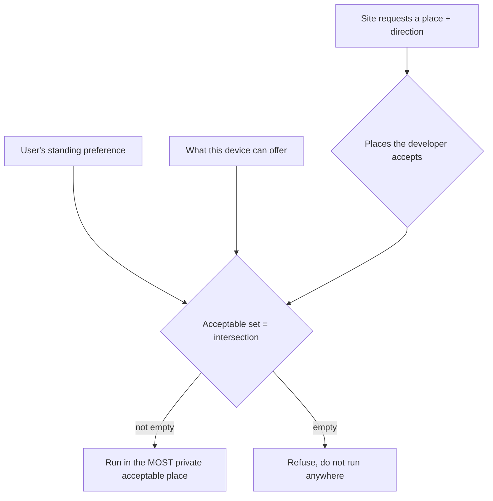

# Compute Location API (CLAPI): User Control Over Computation Placement

## Authors

- Matthew Tylee Atkinson (Samsung Electronics)
- Ehsan Toreini (Samsung Electronics)

## Participate

- Discussion: [W3C TAG design review #1038](https://github.com/w3ctag/design-reviews/issues/1038)
- Issue tracker: a dedicated repository is planned; until then, please comment on the design review above.

## Table of Contents

<!-- START doctoc generated TOC please keep comment here to allow auto update -->

- [Introduction](#introduction)
- [User-Facing Problem](#user-facing-problem)
  - [Goals](#goals)
  - [Non-goals](#non-goals)
- [User research](#user-research)
- [Proposed Approach](#proposed-approach)
  - [The five places, from most to least private](#the-five-places-from-most-to-least-private)
  - [Who decides: the user wins](#who-decides-the-user-wins)
  - [Dependencies on non-stable features](#dependencies-on-non-stable-features)
  - [Solving confidential on-device processing](#solving-confidential-on-device-processing)
  - [Solving "use the cloud only if you have to"](#solving-use-the-cloud-only-if-you-have-to)
  - [Solving a clean refusal](#solving-a-clean-refusal)
- [Alternatives considered](#alternatives-considered)
  - [A single "on-device" switch](#a-single-on-device-switch)
  - [Numeric privacy levels](#numeric-privacy-levels)
  - [Prior art: Do Not Track (DNT)](#prior-art-do-not-track-dnt)
- [Accessibility, Internationalization, Privacy, and Security Considerations](#accessibility-internationalization-privacy-and-security-considerations)
- [Stakeholder Feedback / Opposition](#stakeholder-feedback--opposition)
- [References & acknowledgements](#references--acknowledgements)

<!-- END doctoc generated TOC please keep comment here to allow auto update -->

## Introduction

Web features increasingly run heavy computations on the user's personal data such as translating a message, summarising a document, analysing a photo. **That work can happen in very different places**: inside a secure chip on the phone, on another device the user owns (inside or outside the local network), or on someone else's server. Those places have very different privacy properties, but today the user has almost no say over which one is used.

**CLAPI** is a small, reusable design that lets any computation-heavy web feature offer that choice. The site names *where* it would like the work to run; the user has already told their user agent *where they are willing to let it run*; and the user agent picks the most private place they both accept, or refuses if there isn't one.

## User-Facing Problem

Different people accept different trade-offs. A journalist analysing a leaked contract may insist the text never leaves their laptop. A commuter using a free translator may happily send text to a server in exchange for a free service. **The web gives neither of them a way to express that preference and have it honoured.**

The best a user can do today is hunt for an operating-system toggle labelled "on-device." That toggle is inconsistent between devices, vague about what it actually guarantees, and invisible to the websites it is meant to constrain.

Developers face the mirror image of this problem. They often have a sensible default in mind (e.g. "run this locally if you can to increase server's available capacity") but no standard, cross-feature way to say so.

### Goals

- Define a **shared vocabulary of "places"** where a computation can run, so every feature describes location the same way.
- Let the user set a constraint once and have **the browser enforce it** across features.
- Let developers state a preferred place, and whether they can tolerate somewhere **more** or **less** private.
- Make the outcome predictable: pick the most private acceptable place, or **fail cleanly**.

### Non-goals

- **Designing the user's settings UI.** How a browser asks the user for their preference is out of scope.
- **Model distribution or loading.** This is about *where* work runs, not how models get there.
- **What local code can see inside the browser.** Sandbox concerns are handled elsewhere.
- **Component lifecycle** (downloading OS or browser pieces from various providers).

## User research

*No formal user research has been conducted yet.* The design is currently motivated by the use cases below and by feedback from the W3C TAG and the Web Machine Learning Working Group. User research to validate the five-place model and the "user wins" default is a planned next step.

## Proposed Approach

CLAPI is **not** a new feature on its own. It is a pattern that other features,e.g. a translation API, a neural-network API, a speech API, adopt so the user's preference means the same thing everywhere.

Two things go into every decision:

1. A **place** the developer requests, drawn from a shared list.
2. A **direction**: is the developer happy to run somewhere *more* private than they asked (the default), or do they need to allow somewhere *less* private (for example, because only a big cloud model can do the job)?

The UA combines those with the **user's own constraint** and with what the **device can actually offer**, then picks a single place.

### The five places, from most to least private

*The list below is context for the proposal: it is the vocabulary CLAPI introduces.*

| Place | Plain-language meaning |
| --- | --- |
| `personal-secure` | On my own device(s), inside a secure chip (TEE). |
| `personal` | On my own device(s). |
| `remote-secure` | On someone else's computer, but *technically* protected (e.g. homomorphic encryption, remote TEE). |
| `remote-attested` | On a provider *legally* bound (a GDPR "processor") not to reuse my data. |
| `remote` | On someone else's computer, with no guarantee. |

They form a spectrum from most private (top) to least private (bottom). A **technical** guarantee ranks above a purely **legal** one, and anything on the user's own devices ranks above anything remote.

### Who decides: the user wins

When a site asks for a computation, the browser works out the set of places that satisfy **all** of:

- what the **developer** will accept (their requested place, plus everything more private, or less private, if they opted into that);
- what the **user** will accept (their standing preference); and
- what the **device** can actually do.

If that set has anything in it, the browser runs the work in the **most private** option available. **If it is empty, the browser does not run the work at all**, it does not quietly fall back to something the user rejected. Where user and developer disagree, **the user's constraint takes precedence**, consistent with the [priority of constituencies](https://www.w3.org/TR/design-principles/#priority-of-constituencies).



*Description of the diagram: the developer's accepted places, the user's preference, and the device's real capabilities are intersected. If the result is non-empty, the browser runs the computation in the most private place in it; if it is empty, the browser refuses rather than downgrading.*

### Dependencies on non-stable features

CLAPI itself introduces no new low-level machinery, so it has **no hard dependency** on non-stable features. Its *value*, however, is realised only when computation features adopt it. The most likely early adopters are still maturing, e.g. the [Web Neural Network API](https://www.w3.org/TR/webnn/) (Candidate Recommendation) and the incubating on-device translation and writing-assistance APIs. This should be understood as adoption surface, not a blocking dependency.

### Solving confidential on-device processing

*A legal-review tool must keep a contract on the user's machine, using the secure chip if present.*

It asks for `personal-secure`. With the default direction, the browser will use that or anything more private (there is nothing more private, so it is `personal-secure` or a clean failure).

```js
// "Run in the secure enclave on my own device — and nowhere less private."
const result = await analyzer.run(contractText, 'personal-secure');
```

### Solving "use the cloud only if you have to"

*A translator prefers to stay on-device, but a long document may need a larger cloud model. The developer opts into a less-private fallback so the feature still works.*

```js
// "Ideally on-device, but I'll accept something less private if needed."
const translation = await translator.run(text, {
  runOn: 'personal',
  or: 'less-privacy-preserving'
});
```

The browser still honours the user's ceiling: if the user has said "never send my data to an unguaranteed server," `remote` stays off the table even though the developer allowed it.

### Solving a clean refusal

*The user's preference and the developer's needs cannot be reconciled. The feature must fail visibly, not silently downgrade.*

```js
try {
  const result = await analyzer.run(input, { runOn: 'personal-secure' });
  useResult(result);
} catch (err) {
  // No acceptable place exists. The failure does not reveal *why*,
  // so a site cannot probe for the user's exact constraint.
  showFallbackUI();
}
```

## Alternatives considered

### A single "on-device" switch

Keep the status-quo OS toggle: one boolean for "on-device" vs "cloud."

#### Pros
- Already exists on some platforms; simple to understand.

#### Cons
- "On-device" is ambiguous, it hides at least four different configurations (secure chip or not; this device or a paired one).
- No way to say "a legally bound processor is fine" or "encrypted cloud is fine."
- Not visible to websites, so features can't cooperate with it.

#### Reason for rejection
It collapses meaningfully different privacy situations into one bit, so it can't express the real preferences users and developers have.

### Numeric privacy levels

Replace the named places with numbers (e.g. level 1 to 5).

#### Pros
- Compact; trivially ordered.

#### Cons
- Opaque: "level 3" tells a reader nothing about the actual guarantee.
- Invites inconsistent interpretation across features.

#### Reason for rejection
Named, defined places are self-documenting and far easier to reason about and review than bare numbers.

### Prior art: Do Not Track (DNT)

DNT let users send a "please don't track me" signal to servers. The W3C working group closed in 2019 for lack of deployment, and browsers have since removed the header. Reviewers reasonably ask whether CLAPI repeats this.

#### Pros of the DNT-style approach
- Extremely simple for the user (one signal).
- Universally broadcastable.

#### Cons of the DNT-style approach
- It was a **request a server could ignore**, with no enforcement, and industry largely did ignore it [[DNT-LWN]](#references--acknowledgements) [[DNT-GPC]](#references--acknowledgements).
- It never resolved what its **default** should be, and a rarely-sent signal became a fingerprinting vector.
- It ran **against** the ad industry's incentives, guaranteeing resistance.

#### Reason for rejection
CLAPI is different in kind, so it does not inherit DNT's failure modes:

- **Enforced by the browser, not requested of a server.** The work is simply never dispatched to a place the user rejected. No third party's cooperation is needed. This *complements* server-side law like the [GDPR](#references--acknowledgements) rather than replacing it, and the DNT successor, [Global Privacy Control](#references--acknowledgements), shows the pattern only worked once it gained legal force under the CCPA.
- **With the grain of the market.** It gives users control over a shift already underway, the move of inference toward on-device and edge execution, which the [WebNN](https://www.w3.org/TR/webnn/) effort is explicitly built around.
- **No default/legitimacy dispute.** The privacy-preserving default lives *inside* the browser's decision, not in a broadcast signal a recipient can contest, and the user's constraint is never sent to sites, avoiding DNT's rarity-driven fingerprinting problem.

The fuller argument lives in the companion specification's "Relationship to Do Not Track" section.

## Accessibility, Internationalisation, Privacy, and Security Considerations

**Privacy** is the whole point: the decision procedure is itself a privacy control, and the user's constraint always caps how far data can travel. 
The main new risk is **fingerprinting**, a site probing which places succeed to infer the user's settings. The design mitigates this by requiring user activation or rate limiting, and by making refusals uniform so they don't reveal *which* constraint applied.
Another privacy risk could be the lack of proper security or legal guarantees when TEE is used or the user requested the Cloud-service with legal bindings. The design addresses this by giving the users control on the TEE vs non-TEE execution. The privacy-concerned user is in the best position to decide on how efficient their device's TEE operates. The legal binding is inherenting the same loose bindings as another privacy-focused spec (GPC). It relies on the self-declaration and honesty of the server on the intentions and the legal bindings. The legal consequences of such declaration is out of scope of this spec and the server is fully responsible for the declarations made.

**Internationalisation**: the place identifiers are fixed, locale-independent strings meant for code, not display. Any user-facing labels (and the settings UI, which is out of scope) should be localised by the browser.

**Accessibility**: CLAPI has no direct effect on assistive technology. Indirectly, letting users keep work on-device can improve reliability and offline availability, which benefits users on constrained or intermittent connections. Any browser UI built on top of this must itself be accessible.

**Security**: keeping data in more private places reduces exposure, but CLAPI does not by itself verify a remote party's claims; a browser must not classify an environment as more private than it can actually confirm.

## Stakeholder Feedback / Opposition

- **W3C TAG**: Raised the similarity-to-DNT question; addressed above and in the companion spec.
- **Web Machine Learning Working Group**: Raised the same DNT concern; discussion ongoing.
- **Browser implementors**: No public signals yet.

## References & acknowledgements

Many thanks for valuable feedback and advice from participants in the W3C TAG and the Web Machine Learning Working Group.

Prior art and related work that informed this proposal (alphabetical):

- **[DESIGN-PRINCIPLES]** M. Thomson; J. Yasskin. *Web Platform Design Principles.* W3C. https://www.w3.org/TR/design-principles/
- **[DNT-CLOSURE]** *Tracking Protection Working Group* (closed January 2019). W3C. https://www.w3.org/2011/tracking-protection/
- **[DNT-GPC]** *Is GPC the new 'do not track'?* IAPP, 2022. https://iapp.org/news/a/is-gpc-the-new-do-not-track
- **[DNT-LWN]** *The sad, slow-motion death of Do Not Track.* LWN.net, 2020. https://lwn.net/Articles/826575/
- **[EXPLAINER-EXPLAINER]** M. Tylee Atkinson; J. Yasskin. *Writing Effective Explainers.* W3C. https://www.w3.org/TR/explainer-explainer/
- **[GDPR]** Regulation (EU) 2016/679 (General Data Protection Regulation). https://eur-lex.europa.eu/eli/reg/2016/679/oj
- **[GPC]** *Global Privacy Control.* https://globalprivacycontrol.org/
- **[RFC2119]** S. Bradner. *Key words for use in RFCs to Indicate Requirement Levels.* BCP 14, RFC 2119. https://www.rfc-editor.org/rfc/rfc2119
- **[WEBNN]** *Web Neural Network API.* W3C Candidate Recommendation. https://www.w3.org/TR/webnn/
